<picture>
  <source media="(prefers-color-scheme: dark)" srcset="./assets/hero-dark.svg">
  <source media="(prefers-color-scheme: light)" srcset="./assets/hero-light.svg">
  
</picture>

 

### نظام تشغيل واحد للتاجر الصغير

**محسوم** منصة واحدة لأصحاب المشاريع في مصر. التاجر بيفعّل الموديول اللي محتاجه بس، وكل موديول اسمه فعل أمر من كلمة واحدة بيقول هيعمل إيه بالظبط. الأم هي الدايرة كاملة، والأفعال هي أجزاءها.

<b>Mahsoom</b> is a modular business OS for small merchants in Egypt. Merchants switch on only the modules they need. Every module is named with a single Arabic imperative that says exactly what it does: one parent, one seal, one domain.

 

<picture>
  <source media="(prefers-color-scheme: dark)" srcset="./assets/modules-dark.svg">
  <source media="(prefers-color-scheme: light)" srcset="./assets/modules-light.svg">
  
</picture>

 

| | الموديول | بيعمل إيه | الحالة |
|:--|:--|:--|:--|
| ◆ | **أسّس من محسوم** · Establish | موقعك أو متجرك جاهز ومنشور على دومينك أنت | المرحلة الأولى |
| ◆ | **أكّد من محسوم** · Confirm | صندوق الطلبات وتأكيدها على واتساب قبل ما تتشحن | المرحلة الأولى |
| ◇ | وزّع · تابع · سلّم | الشحن والمناديب ومتابعة كل شحنة لحظة بلحظة | قريبًا |
| ◇ | حصّل · سوّي | تقفيل الكاش وكشوف حسابات التجار | قريبًا |
| ◇ | اربط | بوابات الدفع وشركات الشحن وأنظمة الـ ERP | قريبًا |

 

  <a href="https://mahsoom.com"><b>mahsoom.com</b></a>

<picture>
  <source media="(prefers-color-scheme: dark)" srcset="./assets/footer-dark.svg">
  <source media="(prefers-color-scheme: light)" srcset="./assets/footer-light.svg">
  
</picture>
